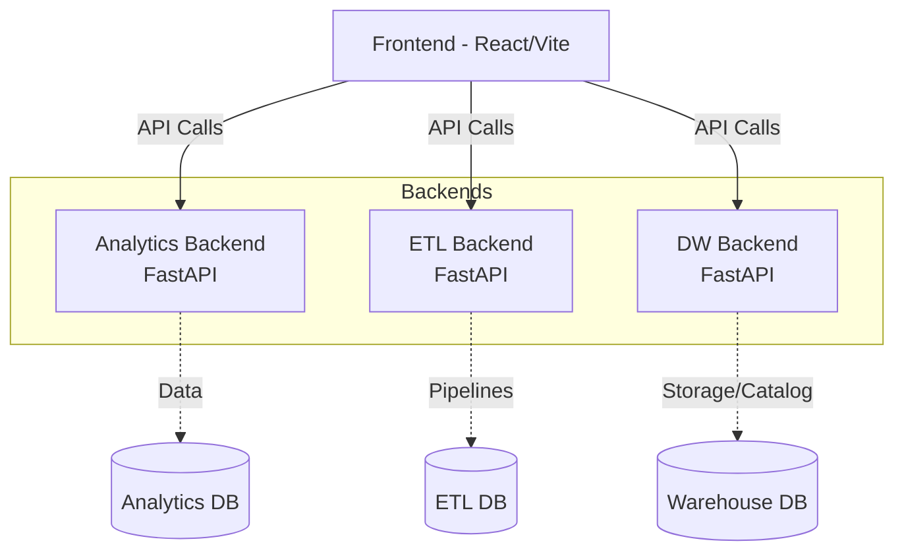

# OneStop Analytics - Project Directory Guide

Welcome to the OneStop Analytics (OSA) project! This guide is designed to help new developers understand the overarching directory structure, how the project is organized into modular services, what each service does, and where to look when you need to make changes.

## 🎯 Executive Summary
The project has been structured into a **Microservices Architecture** with a single unified frontend. Rather than a monolithic backend, the server-side logic is split into three distinct backend services based on their domains: Analytics, ETL (Extract, Transform, Load), and Data Warehouse (DW).

### 🌳 High-Level Architecture Diagram


---

## 📁 Root Directory Layout

At the root level, the project contains the following main folders:

```text
OSA24May-Sanket-New/
├── Analytics-backend/    # FastAPI microservice handling reports, visuals, dashboards, and AI insights.
├── ETL-backend/          # FastAPI microservice for pipeline execution, connectors, and scheduling.
├── dw-backend/           # FastAPI microservice for data warehousing, workspace, catalogs, and SQL execution.
├── frontend/             # React + Vite frontend handling the unified UI for all backend services.
├── DIRECTORY_STRUCTURE.md# Legacy or root-level directory documentation.
├── README.md             # Top-level setup and documentation.
├── start_all.bat         # Script to run all services locally.
└── vercel.json           # Vercel deployment configuration.
```

---

## 🧱 Detailed Module Breakdowns

### 1. `Analytics-backend/` (Analytics Service)
This service manages user-facing analytics, dashboards, worksheets, report generation, AI insights, and visualization logic.

**When to work here**: You need to add a new chart type, modify how an AI insight is generated, change dashboard layouts, or implement Row-Level Security (RLS) on reports.

**Structure & Key Files**:
```text
Analytics-backend/
├── alembic/                # Database migration scripts (Alembic)
├── routers/                # FastAPI endpoint definitions (Controllers)
├── services/               # Core business logic
│   ├── ai_insights.py      # Logic for generating AI analytics insights
│   ├── reports.py          # Paginated and standard report generation
│   ├── visuals.py          # Visualization data formatting
│   ├── worksheets.py       # Worksheet operations
│   └── rls.py              # Row-Level Security logic
├── alembic.ini             # Alembic migration config
├── database.py             # Database connection setup
├── main.py                 # FastAPI application entry point
├── models.py               # SQLAlchemy ORM definitions (Database tables)
├── schemas.py              # Pydantic models (Request/Response validation)
├── tasks.py                # Background/Asynchronous tasks
└── requirements.txt        # Python dependencies for Analytics
```

---

### 2. `ETL-backend/` (ETL Pipeline Service)
This service acts as the orchestration engine for data pipelines. It handles data ingestion from various sources (connectors), transformation steps, and loads data into target databases.

**When to work here**: You need to integrate a new data source connector, fix a bug in the DAG execution, or adjust ETL scheduling logic.

**Structure & Key Files**:
```text
ETL-backend/
├── alembic/                # Database migration scripts
├── app/                    # Main application package
│   ├── api/                # API Endpoints (e.g., triggering pipelines)
│   ├── connectors/         # Source integrations (e.g., PostgreSQL, APIs, S3)
│   ├── engine/             # The core execution engines
│   ├── models/             # SQLAlchemy ORM definitions
│   ├── schemas/            # Pydantic models
│   ├── utils/              # Helper functions
│   ├── config.py           # Environment and app configuration
│   ├── database.py         # DB connection for ETL state tracking
│   └── main.py             # FastAPI entry point for ETL service
├── alembic.ini             # Migration config
└── requirements.txt        # Python dependencies for ETL
```

---

### 3. `dw-backend/` (Data Warehouse Service)
This service handles data warehousing features like SQL query execution, catalog management, managing different database schemas (bronze, silver, gold layers), and workspace file management.

**When to work here**: You need to change how SQL queries are executed against the warehouse, add new catalog metadata features, or modify the file/notebook management system.

**Structure & Key Files**:
```text
dw-backend/
├── app/                    # Main application package
│   ├── common/             # Shared utilities and helpers
│   ├── core/               # Core configuration and DB setup
│   ├── db/                 # Base database schema definitions
│   ├── modules/            # Domain-driven feature modules (Business logic)
│   │   ├── catalog/        # Managing tables, schemas, metadata
│   │   ├── sql/            # SQL execution engine
│   │   └── workspace/      # Managing user workspaces/notebooks
│   ├── services/           # Shared backend services (Execution engines, Spark, etc.)
│   └── main.py             # FastAPI entry point
├── migrate_catalog_schema.py # Script for database migrations
└── requirements.txt        # Python dependencies for DW
```

---

### 4. `frontend/` (React SPA)
The unified user interface that interacts with all three backend microservices. Built with React and Vite.

**When to work here**: You need to change the UI, add a new screen, fix a frontend bug, or connect a React component to a new backend API endpoint.

#### General Frontend Structure
```text
frontend/
├── public/                 # Static assets (favicons, icons)
├── src/                    # Main source code
│   ├── App.jsx             # React App Root & Router
│   ├── main.jsx            # Application mount point
│   ├── index.css           # Global Tailwind/CSS imports
│   ├── assets/             # Images, global stylesheets, fonts
│   ├── shared/             # Reusable UI components (Buttons, Modals, Loaders)
│   └── modules/            # Feature-specific React code (Detailed below)
├── package.json            # NPM dependencies and scripts
└── vite.config.js          # Vite build and dev server config
```

#### Detailed Module Walkthrough (`src/modules/`)

The `src/modules/` directory is where the core logic and screens for the three main domains live. Here is a cheat sheet on exactly where to go when you need to make specific changes.

**1. Analytics Module (`src/modules/analytics/`)**
Contains the UI for data visualization, paginated reports, and dashboards.
* **If you want to update the Main Analytics Dashboard Layout:** Edit `pages/AnalyticsDashboard.jsx` (and its CSS `pages/AnalyticsDashboard.css`).
* **If you want to add/edit the PDF Report Builder UI:** Edit `pages/PaginatedReportBuilder.jsx`.
* **If you want to change how specific charts render:** Look inside the `components/` folder for the individual chart components.
* **If you want to change API calls for analytics:** Edit files in `services/`.

**2. DW (Data Warehouse) Module (`src/modules/dw/`)**
Contains the UI for managing the data catalog, workspace notebooks, and executing SQL.
* **If you want to update the Catalog Explorer (Schema/Table Tree):** Edit `catalog/CatalogSidebar.jsx` and `catalog/Catalog.jsx`.
* **If you want to change the Table Metadata View:** Edit `catalog/TableDetailsView.jsx` or `catalog/TableTabContent.jsx`.
* **If you want to update the SQL Editor (IDE) UI:** Edit `sql/SqlLab.jsx` (Main wrapper) and `sql/SqlEditor.jsx` (Monaco editor implementation).
* **If you want to change how Query Results are displayed:** Edit `sql/ResultsPanel.jsx`.
* **If you want to update the Notebook/File Explorer UI:** Edit `workspace/WorkspacePage.jsx` and `workspace/WorkspaceSidebar.jsx`.

**3. ETL Module (`src/modules/etl/`)**
Contains the UI for building, scheduling, and monitoring data pipelines.
* **If you want to update the visual Pipeline Builder Canvas (DAG):** Edit `PipelineEditor/PipelineEditor.jsx`.
* **If you want to add a new Node type to the Sidebar:** Edit `PipelineEditor/Sidebar.jsx` to add the drag-and-drop item, and create the node in `PipelineEditor/nodes/`.
* **If you want to change the Properties Panel (Side panel for configuring nodes):** Edit `PipelineEditor/PropertiesPanel.jsx`.
* **If you want to update the list of Pipelines/Jobs:** Edit `Pipelines/PipelineList.jsx` or `Jobs/JobMonitor.jsx`.
* **If you want to modify Data Source Connectors (e.g., S3, Postgres forms):** Look in the `connectors/` folder.

> [!NOTE]
> **Golden Rule for Frontend Edits**: First, identify which visual page you are on (Analytics, DW, or ETL). Then, find the corresponding folder in `src/modules/`. Open the root `.jsx` file for that view (usually in `pages/` or the root of that sub-module) and trace down into its imported `components/`.

By keeping these modules separated, the frontend codebase remains scalable and aligns perfectly with the backend microservices structure.

---

## 🔄 Common Patterns Across All Modules

Regardless of which backend you are working in (`Analytics`, `ETL`, or `DW`), you will notice a consistent architectural pattern:

1. **`main.py`**: The heart of the FastAPI app. Start here to see how routes are mounted and middleware is configured.
2. **`models` / `models.py`**: Contains SQLAlchemy models representing physical database tables. Change these if you need to add columns to the DB.
3. **`schemas` / `schemas.py`**: Contains Pydantic models. Change these if you need to modify the JSON structure of an API request or response.
4. **`routers` / `api`**: Contains the FastAPI `@app.get` or `@app.post` endpoints. They should purely handle HTTP routing and call `services` for logic.
5. **`services`**: Contains the actual business logic, database queries, and data processing.
6. **`alembic/` & `alembic.ini`**: Used for database migrations. If you change a `models.py` file, you MUST generate and apply a new Alembic migration.
7. **`.env` / `config.py`**: Where environment variables (Database URLs, API keys) are loaded.

## 🚀 Getting Started Checklist for a New Developer

1. **Environment Setup**: Ensure you have Python and Node.js installed.
2. **Install Dependencies**:
   - Run `pip install -r requirements.txt` in each backend folder.
   - Run `npm install` in the `frontend` folder.
3. **Database Configuration**: Ensure PostgreSQL/MongoDB are running, and set up the respective `.env` files in each backend service.
4. **Run Migrations**: Apply Alembic migrations for Analytics and ETL backends.
5. **Start Services**: You can use `start_all.bat` on Windows to boot up all services simultaneously, or start them individually.
   - Backend: `uvicorn main:app --reload` (or the respective app path)
   - Frontend: `npm run dev`

> [!TIP]
> If you are building a full-stack feature, you will typically need to touch **one** backend repository (e.g., `Analytics-backend`) and the corresponding folder inside `frontend/src/modules/`.
